# Computer vision for pick-and-place in FRET

**From camera images to the ball grasp pose: mathematical model,
implementation, and error analysis**

*FRET — `fret.vision` module — October 2026*

> **Abstract.** This document gives a mathematically rigorous description of
> the vision algorithm FRET uses to locate a ball on the table and turn that
> location into grasp targets for the OpenMANIPULATOR-X (OM-X) and
> OpenMANIPULATOR-Y (OMY) arms. The full chain is: rendering two calibrated
> MuJoCo cameras; thresholding in HSV space; morphological filtering; contour
> extraction and selection by circularity; centre estimation with the minimum
> enclosing circle; back-projection of the pixel as a world ray; intersection
> with the horizontal plane that contains the ball centre; weighted fusion of
> the views; and inverse kinematics of the fingertip midpoint. For each stage
> we give the formulation, the assumptions, and propositions with proofs
> (shape of the projected sphere silhouette, perspective bias, behaviour of
> the minimum enclosing circle under occlusion, digital limit of circularity,
> Jacobian of the plane lift). Every number was produced by running the
> repository code (`scripts/vision_algorithm_figures.py`), and every closed
> form was checked numerically against the implementation.

The LaTeX version of this document is `vision_algorithm.tex` (PDF:
`vision_algorithm.pdf`). Both are generated from the same run and contain the
same numbers.

## Contents

1. [Overview](#1-overview)
2. [Camera model](#2-camera-model)
3. [Colour segmentation in HSV space](#3-colour-segmentation-in-hsv-space)
4. [Morphological filtering](#4-morphological-filtering)
5. [Contours, circularity, and centre](#5-contours-circularity-and-centre)
6. [Geometry of the sphere silhouette](#6-geometry-of-the-sphere-silhouette)
7. [From pixel to world: lifting to the table plane](#7-from-pixel-to-world-lifting-to-the-table-plane)
8. [Error analysis](#8-error-analysis)
9. [Results in simulation](#9-results-in-simulation)
10. [From ball position to grasp pose](#10-from-ball-position-to-grasp-pose)
11. [Limitations and possible improvements](#11-limitations-and-possible-improvements)
- [Appendix A. Configuration parameters](#appendix-a-configuration-parameters)
- [Appendix B. Reproducibility](#appendix-b-reproducibility)
- [References](#references)

---

## 1. Overview

The `fret.vision` module solves the following problem. Given RGB images from
$N \geq 1$ calibrated cameras, estimate the world-frame position
$\mathbf{p}^\star \in \mathbb{R}^3$ of the centre of a ball of known radius
$r$ resting on a horizontal table of known height $z_{\text{table}}$. The
controller then uses the estimate $\hat{\mathbf{p}}$ to compute the approach,
grasp, and lift joint configurations.

The code is split into three stages behind algorithm-agnostic protocols
(`fret/vision/protocols.py`): a *detector* (image $\to$ pixel hypotheses), an
optional *tracker* (unused in the current configuration), and a *pose lifter*
(pixels $\to$ world). Orchestration lives in `BallVisionPipeline.process`
(`fret/vision/pipeline.py`); the concrete wiring is in
`fret/vision/factory.py`.

```text
 fret.simulation         HsvBlobBallDetector
+----------------+   I   +--------------+  M0  +-------------+   M   +---------------+
| MuJoCo cameras | ----> | RGB -> HSV   | ---> | opening and | ----> | contours,     |
| left and right |       | threshold    |      | closing     |       | circularity,  |
| 1280 x 720     |       | (Sec. 3)     |      | (Sec. 4)    |       | MEC (Sec. 5)  |
+----------------+       +--------------+      +-------------+       +---------------+
                                                                        | (u, v), c
                                                                        v
+----------------+       +-----------------+  p_i  +-----------------+  +---------------+
| grasp targets  | <---- | BallObservation | <---- | weighted fusion | <-| ray ∩ plane   |
| + fingertip IK |       | p_hat in R^3    |       | of the views    |  | z = z_tab + r |
| (Sec. 10)      |       +-----------------+       | (Sec. 7.3)      |  | (Sec. 7)      |
+----------------+                                 +-----------------+  +---------------+
 fret.control.pick_place_vision                     TablePlanePoseLifter
```

*Figure 1. End-to-end flow from images to grasp. Each view is processed
independently until fusion.*

**Scene.** In the pick-and-place cells (OM-X and OMY), two cameras are
mounted on the top corners of a structural gate behind the arm
(`docs/vision/camera-layout.md`). The ball is yellow-green (material colour
$\text{RGBA} = (0.85, 0.92, 0.20, 1)$) with radius {{OmxBallr}} mm in the OM-X
cell and {{OmyBallr}} mm in the OMY cell. Figure 2 shows both views at the
OM-X default pick pose, and Figure 3 shows the final estimate overlaid on the
scene.

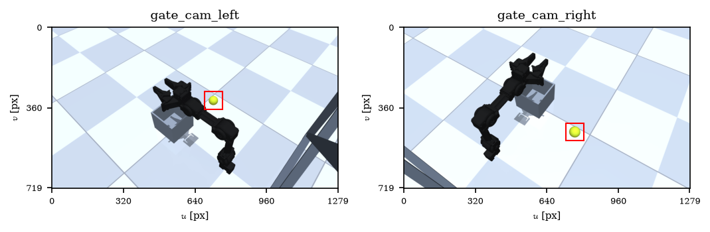

*Figure 2. Images rendered by the two gate cameras (OM-X, ball at
$(0.22, -0.20)$ m). The red square marks the region enlarged in Figure 5.*

| OM-X | OMY |
|:---:|:---:|
| 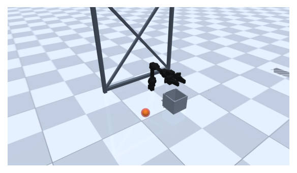 | 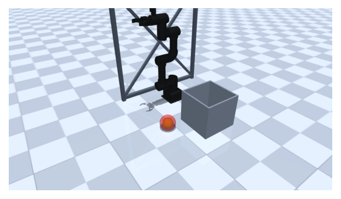 |

*Figure 3. Cell overview. The translucent red sphere (`cv_ball_ghost`, visual
only) is placed at the vision estimate $\hat{\mathbf{p}}$; the real yellow
ball sits inside it.*

**Notation.** Vectors are bold; $\mathbf{e}_z = (0,0,1)^{\mathsf{T}}$;
$\tilde{\mathbf{u}} = (u,v,1)^{\mathsf{T}}$ are homogeneous pixel coordinates;
$[\,\cdot\,]_{xy}$ keeps the first two components. Angles are in radians
unless stated. Subscripts $L$ and $R$ refer to the left (`gate_cam_left`) and
right (`gate_cam_right`) cameras.

---

## 2. Camera model

### 2.1 Frames

Three frames are used: the world $\{W\}$ (origin at the arm base, $x$
forward, $z$ up); the MuJoCo camera $\{M\}$, which looks along $-z_M$ with
$y_M$ up in the image; and the OpenCV optical camera $\{C\}$, with $x_C$ to
the right, $y_C$ down, and $z_C$ into the scene. The whole pipeline works in
$\{C\}$.

MuJoCo provides the optical centre $\mathbf{O} \in \mathbb{R}^3$ (`cam_xpos`)
and the matrix $R_M \in SO(3)$ (`cam_xmat`), whose columns are the axes of
$\{M\}$ expressed in $\{W\}$. Since $x_C = x_M$, $y_C = -y_M$, and
$z_C = -z_M$,

$$
R = R_M \operatorname{diag}(1,-1,-1), \qquad
T_{WC} = \begin{bmatrix} R & \mathbf{O} \\ \mathbf{0}^{\mathsf{T}} & 1 \end{bmatrix},
\tag{1}
$$

implemented in `mujoco_xmat_to_opencv_rotation`
(`fret/simulation/mujoco_camera.py`). $R$ is still a rotation: it is a product
of orthogonal matrices and $\det R = \det R_M \cdot (1)(-1)(-1) = 1$. The
transform maps camera coordinates to world coordinates:
$\mathbf{x}_W = R\,\mathbf{x}_C + \mathbf{O}$.

### 2.2 Pinhole projection and intrinsics

With the intrinsic matrix

$$
K = \begin{bmatrix} f_x & 0 & c_x \\ 0 & f_y & c_y \\ 0 & 0 & 1 \end{bmatrix},
$$

a point $\mathbf{x}_W$ in front of the camera projects to

$$
\mathbf{x}_C = R^{\mathsf{T}}(\mathbf{x}_W - \mathbf{O}) = (X, Y, Z)^{\mathsf{T}},
\qquad
u = f_x \frac{X}{Z} + c_x, \quad v = f_y \frac{Y}{Z} + c_y, \quad Z > 0.
\tag{2}
$$

The simulator has no lens distortion, and `CameraIntrinsics` deliberately
omits distortion coefficients.

MuJoCo defines a camera by its vertical field of view $\phi_y$ (`fovy`). On
the plane $Z = 1$ the visible half-height is $\tan(\phi_y/2)$, which spans
$H/2$ pixels; with square pixels,

$$
f_x = f_y = f = \frac{H/2}{\tan(\phi_y/2)}, \qquad
c_x = \frac{W-1}{2}, \quad c_y = \frac{H-1}{2}
\tag{3}
$$

(`intrinsics_from_fovy`). The principal point uses the convention that pixel
$(i,j)$ is centred at integer coordinates $(i,j)$, the same convention OpenCV
uses for contours. For $H = 720$: with $\phi_y = {{OmxFovy}}^\circ$ (OM-X),
$f = 360/\tan(21^\circ) = {{OmxFx}}$ px; with $\phi_y = {{OmyFovy}}^\circ$
(OMY), $f = 360/\tan(22.5^\circ) = {{OmyFx}}$ px. In both cases
$(c_x, c_y) = (639.5, 359.5)$.

**Calibration consistency.** The $K$ and $T_{WC}$ of each camera are stored in
`omx_portal_overhead.yml` and `omy_portal_overhead.yml`. Against the loaded
MuJoCo model, the largest difference between the YAML $T_{WC}$ and the one
computed from the model is {{OmxCalExt}} (OM-X) and {{OmyCalExt}} (OMY); the
difference in $f$ and $c$ is $\leq$ {{OmyCalFx}} px; and
$\max|R^{\mathsf{T}}R - I| \leq$ {{OmyCalOrth}} with
$|\det R - 1| \leq$ {{OmyCalDet}}. The calibration used by the pipeline
therefore matches the rendered geometry up to YAML rounding.

---

## 3. Colour segmentation in HSV space

### 3.1 RGB to HSV conversion (OpenCV, 8 bits)

Let $I : \Omega \to \{0,\dots,255\}^3$ be the RGB image, with
$\Omega = \{0,\dots,W-1\} \times \{0,\dots,H-1\}$. For a pixel $(R,G,B)$ let
$M_{\max} = \max(R,G,B)$, $m = \min(R,G,B)$, and $\Delta = M_{\max} - m$.
OpenCV computes

$$
V = M_{\max}, \qquad
S = \begin{cases} 255\,\Delta / M_{\max}, & M_{\max} > 0 \\ 0, & M_{\max} = 0 \end{cases}
$$

$$
H' = \begin{cases}
60\,(G-B)/\Delta, & M_{\max} = R \\
120 + 60\,(B-R)/\Delta, & M_{\max} = G \\
240 + 60\,(R-G)/\Delta, & M_{\max} = B
\end{cases}
\quad (H' \leftarrow H' + 360 \text{ if } H' < 0), \qquad H = H'/2,
$$

rounded to integers. $H \in \{0,\dots,179\}$ is the hue in degrees divided by
two, and $S, V \in \{0,\dots,255\}$. The code converts RGB $\to$ BGR $\to$ HSV
(`_to_bgr` and `cv2.cvtColor`).

**Example.** The ball's diffuse colour, $(217, 235, 51)$, has
$M_{\max} = G = 235$, $m = 51$, and $\Delta = 184$. Hence $V = 235$,
$S = 255 \cdot 184 / 235 \approx 199.7 \to 200$, and
$H' = 120 + 60(51-217)/184 \approx 65.9$, so $H = 33$. `cv2.cvtColor` returns
exactly $(33, 200, 235)$.

### 3.2 Threshold

**Definition 1 (Colour mask).** Given bounds
$\boldsymbol{\ell}, \mathbf{h} \in \{0,\dots,255\}^3$, the initial mask is

$$
M_0(\mathbf{x}) = \begin{cases}
255, & \boldsymbol{\ell} \preceq \operatorname{hsv}(I(\mathbf{x})) \preceq \mathbf{h} \\
0, & \text{otherwise,}
\end{cases}
$$

where $\preceq$ is the component-wise order with inclusive bounds
(`cv2.inRange`). If the configuration defines a second range
$[\boldsymbol{\ell}', \mathbf{h}']$, then $M_0 \leftarrow M_0 \vee M_0'$. The
second range exists because hue is circular: a red object occupies both
$H \approx 0$ and $H \approx 179$ and needs two intervals.

In the gate cells, $\boldsymbol{\ell} = (20, 40, 40)$ and
$\mathbf{h} = (50, 255, 255)$, with no second range. Figure 4 justifies the
choice with data. The ball pixels, identified by MuJoCo's segmentation render
(the ground truth), lie in $H \in [{{OmxHsvBallHPab}}, {{OmxHsvBallHPjj}}]$
(1st and 99th percentiles), with median
$(H, S, V) = ({{OmxHsvBallHMedian}}, {{OmxHsvBallSMedian}}, {{OmxHsvBallVMedian}})$.
The floor and the gate sit at $H \approx 90$–$120$ or have low $S$. At the
default pose, {{OmxHsvBallFracInside}} % of ball pixels fall inside the
threshold box, and {{OmxHsvBgFracInside}} % of an 80,000-pixel background
sample does (OMY: {{OmyHsvBallFracInside}} % and {{OmyHsvBgFracInside}} %).
The ball's minimum $V$ ({{OmxHsvBallVPab}}, on the shaded side) is well above
$\ell_V = 40$, which leaves room for lighting variation.

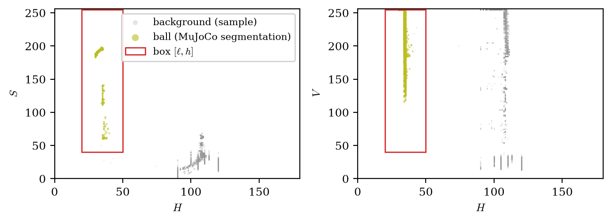

*Figure 4. Ball pixels (olive, MuJoCo segmentation labels) and a background
sample (grey) in the $H$–$S$ and $H$–$V$ planes, with the OM-X threshold box
$[\boldsymbol{\ell}, \mathbf{h}]$. Both cameras are included.*

---

## 4. Morphological filtering

Identify the binary mask with the set
$X = \{\mathbf{x} \in \Omega : M_0(\mathbf{x}) \neq 0\} \subset \mathbb{Z}^2$.
Let $B \subset \mathbb{Z}^2$ be a symmetric structuring element ($B = -B$)
centred at the origin, and $B_{\mathbf{x}} = \mathbf{x} + B$.

**Definition 2.** Erosion
$X \ominus B = \{\mathbf{x} : B_{\mathbf{x}} \subseteq X\}$; dilation
$X \oplus B = \{\mathbf{x} : B_{\mathbf{x}} \cap X \neq \emptyset\}$; opening
$X \circ B = (X \ominus B) \oplus B$; closing
$X \bullet B = (X \oplus B) \ominus B$.

The detector computes $M = (M_0 \circ B) \bullet B$ (`mask_for_frame`), with
the structuring element returned by
`cv2.getStructuringElement(cv2.MORPH_ELLIPSE, (5, 5))`:

$$
B = \begin{bmatrix}
0&0&1&0&0 \\ 1&1&1&1&1 \\ 1&1&1&1&1 \\ 1&1&1&1&1 \\ 0&0&1&0&0
\end{bmatrix}.
$$

**Proposition 1 (Properties used).** (i)
$X \circ B = \bigcup \{B_{\mathbf{y}} : B_{\mathbf{y}} \subseteq X\} \subseteq X$:
opening keeps exactly the points covered by some translate of $B$ that fits
inside $X$. (ii) $X \subseteq X \bullet B$ and
$(X \bullet B)^c = X^c \circ B$. (iii) Both operations are increasing and
idempotent.

*Proof.* (i) $\mathbf{z} \in (X \ominus B) \oplus B$ if and only if there is
$\mathbf{y}$ with $B_{\mathbf{y}} \subseteq X$ and $\mathbf{z} \in B_{\mathbf{y}}$
(by symmetry of $B$). (ii) By the duality $(X \oplus B)^c = X^c \ominus B$,
$(X \bullet B)^c = (X^c \ominus B) \oplus B = X^c \circ B$; the inclusion
follows from (i) applied to $X^c$. (iii) This is the classical result of
Matheron and Serra [2]. $\blacksquare$

In practice, by Proposition 1(i), opening deletes any false-positive
component that cannot contain a copy of $B$ (isolated pixels, 1–2 px-wide
lines on object edges). By (ii), closing fills holes and notches in the
complement that cannot contain $B$, such as a specular highlight or the cut
left by a thin edge in front of the ball. For an unoccluded ball of radius
$\approx 20$–$36$ px, both operations barely change the silhouette
(Figure 5).

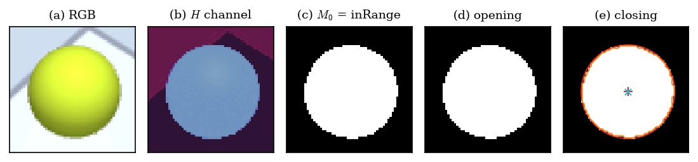

*Figure 5. Detector stages on the left camera (OM-X, default pose),
$56 \times 56$ px crop. (e) External contour (orange), minimum enclosing
circle (red), and estimated centre (+). The cyan × is the exact projection of
the ball centre by Eq. (2).*

---

## 5. Contours, circularity, and centre

### 5.1 Contour extraction

The detector extracts the outer borders of the 8-connected components of $M$
with the Suzuki–Abe border-following algorithm [3] (`cv2.findContours`, mode
`RETR_EXTERNAL`). Each contour is a closed polygon
$\mathcal{P} = (\mathbf{q}_0, \dots, \mathbf{q}_{n-1})$ whose vertices are
border pixel centres. `CHAIN_APPROX_SIMPLE` only removes intermediate vertices
of horizontal, vertical, or diagonal runs, so the polygon (as a subset of the
plane) is unchanged.

### 5.2 Area, perimeter, and circularity

$$
A(\mathcal{P}) = \frac{1}{2}\left|\sum_{k=0}^{n-1}\left(x_k y_{k+1} - x_{k+1} y_k\right)\right|,
\qquad
P(\mathcal{P}) = \sum_{k=0}^{n-1} \|\mathbf{q}_{k+1} - \mathbf{q}_k\|,
\qquad
c = \frac{4\pi A}{P^2},
\tag{4}
$$

with indices modulo $n$ (`contourArea`, `arcLength`, `_circularity`). Because
the vertices lie on the lattice $\mathbb{Z}^2$, Pick's theorem gives, for a
simple polygon, $A = I + B_\partial/2 - 1$, with $I$ interior lattice points
and $B_\partial$ lattice points on the border. So $A$ is about half a pixel
layer below the pixel count of the component. In the example of Section 7.4,
$A = {{OmxLAreaPx}}$ against {{OmxLSegpx}} visible ball pixels in the
reference segmentation and {{OmxLEllArea}} px² of theoretical silhouette
area.

By the isoperimetric inequality, $P^2 \geq 4\pi A$ for any closed plane
curve, with equality only for the circle. Hence $c \in (0, 1]$, and $c = 1$
characterises the disk in the continuum. In the digital case the attainable
maximum is lower:

**Proposition 2 (Digital limit of circularity).** Let $\mathcal{P}_R$ be the
outer contour of a digitised disk of radius $R$. As $R \to \infty$,

$$
\frac{P(\mathcal{P}_R)}{2\pi R} \to \frac{8}{\pi}(\sqrt{2} - 1) \approx 1.05479,
\qquad
c(\mathcal{P}_R) \to c_\infty = \left(\frac{\pi}{8(\sqrt{2} - 1)}\right)^2 \approx 0.8988.
$$

*Proof.* By symmetry it suffices to consider one octant. There the tangent to
the circle makes an angle $\theta \in [0, \pi/4]$ with the dominant axis, and
the contour is an 8-connected path of axial steps (length 1) and diagonal
steps ($\sqrt{2}$). Per unit advance along the dominant axis, the path takes
$\tan\theta$ diagonal steps and $1 - \tan\theta$ axial steps. Since an arc
element $ds$ advances $\cos\theta\,ds$, the path length per unit arc length is
$\cos\theta\,[(1 - \tan\theta) + \sqrt{2}\tan\theta] = \cos\theta + (\sqrt{2} - 1)\sin\theta$.
On a circle, $\theta$ is proportional to arc length, so the octant average is

$$
\frac{4}{\pi}\int_0^{\pi/4}\left(\cos\theta + (\sqrt{2} - 1)\sin\theta\right)d\theta
= \frac{4}{\pi}\left(2\sqrt{2} - 2\right) = \frac{8}{\pi}(\sqrt{2} - 1).
$$

The relative area error is $O(P/R^2) = O(1/R)$, so $A/(\pi R^2) \to 1$, and
the limit of $c$ follows from (4). $\blacksquare$

Figure 7(a) confirms the proposition numerically with the same OpenCV code:
the mean circularity of digital disks is {{CircCircRf}} at $R = 5$ px,
{{CircCircRda}} at $R = 30$ px, and {{CircCircRga}} at $R = 60$ px, i.e.
$c_\infty$ to three decimals. This explains why the configured threshold,
$c_{\min} = 0.45$ (gate) or $0.55$ (fixture), is far below 1. The silhouette
of a sphere is a slightly elongated ellipse (Section 6). Even at the image
corner, with axis ratio $b/a \approx \cos\alpha \approx 0.76$, the continuous
circularity of that ellipse is $\approx 0.97$, which still leaves a wide
margin above $c_{\min}$.

### 5.3 Filters and selection

A contour is accepted if $A_{\min} \leq A \leq A_{\max}$ and
$c \geq c_{\min}$. Among the accepted ones the detector picks

$$
k^\star = \arg\max_k s_k, \qquad
s_k = c_k + 0.05 \min\left(1, A_k / A_{\max}\right),
\tag{5}
$$

and returns *at most one* detection per camera, with confidence
$\kappa = \operatorname{clip}(c_{k^\star}, 0, 1)$. With
$A_{\max} = 500{,}000$ px² and balls of $\lesssim 4000$ px², the area term is
below $4 \times 10^{-4}$: selection is effectively by highest circularity, and
area only breaks ties.

### 5.4 Centre from the minimum enclosing circle

**Definition 3.** The minimum enclosing circle (MEC) of a compact set
$S \subset \mathbb{R}^2$ is the smallest closed disk that contains $S$. It
exists and is unique [4].

The detector defines the image centre $(\hat{u}, \hat{v})$ and radius
$\hat{\rho}$ of the ball as the centre and radius of the MEC of the selected
contour's vertices (`cv2.minEnclosingCircle`). OpenCV's implementation is
exact on the real detections of Section 9: the largest vertex-to-centre
distance differs from the returned radius by at most {{OmxMecGap}} px (OM-X)
and {{OmyMecGap}} px (OMY). The next two propositions explain what this
centre measures.

---

## 6. Geometry of the sphere silhouette

**Proposition 3 (Projected sphere silhouette).** Let a sphere of radius $r$
have its centre, in $\{C\}$, at distance $D$ from the optical centre and at
angle $\alpha$ from the optical axis. Let $\beta = \arcsin(r/D)$ and
$\alpha + \beta < \pi/2$. In normalised coordinates ($Z = 1$), rotated about
the optical axis so that the projected centre lies on the half-axis $x > 0$,
the silhouette is the ellipse

$$
\frac{(x - x_0)^2}{a^2} + \frac{y^2}{b^2} = 1, \quad
x_0 = \frac{\sin\alpha\cos\alpha}{\mathcal{A}}, \;
a = \frac{\sin\beta\cos\beta}{\mathcal{A}}, \;
b = \frac{\sin\beta}{\sqrt{\mathcal{A}}}, \;
\mathcal{A} = \cos^2\beta - \sin^2\alpha.
$$

In particular, the ellipse centre is shifted radially outward from the
projection of the sphere centre, $\tan\alpha$, by

$$
\delta = x_0 - \tan\alpha = \frac{\tan\alpha \sin^2\beta}{\cos^2\beta - \sin^2\alpha} \geq 0.
\tag{6}
$$

*Proof.* The rays tangent to the sphere form a circular cone with axis
$\hat{\mathbf{c}} = (\sin\alpha, 0, \cos\alpha)$ and half-angle $\beta$: a
vector $\mathbf{d} = (x, y, 1)$ lies on the cone if and only if
$(\mathbf{d} \cdot \hat{\mathbf{c}})^2 = \cos^2\beta\,\|\mathbf{d}\|^2$, i.e.

$$
(x\sin\alpha + \cos\alpha)^2 = \cos^2\beta\,(x^2 + y^2 + 1).
$$

Rearranging,
$\mathcal{A}x^2 - 2x\sin\alpha\cos\alpha + \cos^2\beta\,y^2 = \cos^2\alpha - \cos^2\beta$.
Completing the square in $x$,

$$
\mathcal{A}(x - x_0)^2 + \cos^2\beta\,y^2
= \cos^2\alpha - \cos^2\beta + \frac{\sin^2\alpha\cos^2\alpha}{\mathcal{A}}
= \frac{\cos^2\beta\sin^2\beta}{\mathcal{A}},
$$

where the last equality follows from expanding the numerator,
$(\cos^2\alpha - \cos^2\beta)(\cos^2\beta - \sin^2\alpha) + \sin^2\alpha\cos^2\alpha = \cos^2\beta(1 - \cos^2\beta)$.
Dividing by the right-hand side gives $a$ and $b$; $\mathcal{A} > 0$ because
$\alpha + \beta < \pi/2$. For the bias,
$x_0 - \tan\alpha = \sin\alpha(\cos^2\alpha - \mathcal{A})/(\mathcal{A}\cos\alpha)$
and $\cos^2\alpha - \mathcal{A} = 1 - \cos^2\beta = \sin^2\beta$.
$\blacksquare$

**Corollary 1.** Without occlusion, and in the continuum limit, the MEC of the
silhouette is the circle with centre $(x_0, 0)$ and radius $a$. The detector
therefore estimates the centre of the *ellipse*, with a systematic radial bias
of $f\delta$ pixels, and $\hat{\rho} \approx fa$.

*Proof.* The ellipse lies in the disk with centre $(x_0, 0)$ and radius $a$
because $b \leq a$ (equivalent to $\mathcal{A} \leq \cos^2\beta$). The
vertices $(x_0 \pm a, 0)$ are antipodal on that disk, and any disk containing
them has radius $\geq a$. By uniqueness of the MEC, it is that disk.
$\blacksquare$

Figure 6 plots $f\delta$ against $\alpha$. The analytic curves match a
numerical projection of 20,001 points of the tangency circle (maximum
difference $< 10^{-3}$ px). In the real geometries, the maximum bias, at the
image corner ($\alpha \approx {{BiasOmxAlphaMaxDeg}}^\circ$ and
${{BiasOmyAlphaMaxDeg}}^\circ$), is {{BiasOmxBiasMaxPx}} px (OM-X) and
{{BiasOmyBiasMaxPx}} px (OMY). In the example of Section 7.4, Eq. (6) predicts
{{OmxLEllBias}} and {{OmxREllBias}} px, and the measured centre errors are
{{OmxLCentreErrPx}} and {{OmxRCentreErrPx}} px. The predicted radii,
$fa = {{OmxLEllA}}$ and {{OmxREllA}} px, agree with the measured
$\hat{\rho} = {{OmxLRadiusPx}}$ and {{OmxRRadiusPx}} px. Since one pixel is
worth $\approx 1$ mm on the table plane (Section 8), this bias contributes
tenths of a millimetre. It could be removed by inverting Eq. (6); today it is
not corrected.

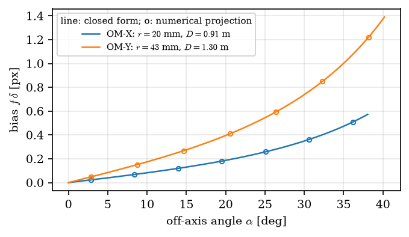

*Figure 6. Perspective bias $f\delta$ (Eq. 6) between the silhouette centre
and the projection of the sphere centre, at the default-pose distance.
Circles are the independent numerical check.*

**Proposition 4 (MEC under occlusion).** Let $\mathcal{D}$ be the silhouette
disk (radius $R$, centre $\mathbf{c}$) and $S \subseteq \mathcal{D}$ the
compact visible part.

- (i) If $S$ contains two antipodal points of $\partial\mathcal{D}$ (for
  example, a border arc of angle $\geq \pi$), then
  $\operatorname{MEC}(S) = \mathcal{D}$ and the estimated centre is exact.
- (ii) If the occluder is a half-plane and less than half the disk is
  visible,
  $S = \mathcal{D} \cap \{\mathbf{x} : \langle \mathbf{x} - \mathbf{c}, \mathbf{n} \rangle \leq -h\}$
  with $0 < h < R$ and $\|\mathbf{n}\| = 1$, then $\operatorname{MEC}(S)$ is
  the disk with the chord as diameter: centre $\mathbf{c} - h\mathbf{n}$,
  radius $\sqrt{R^2 - h^2}$. The centre error is $h$, and the visible
  fraction is
  $f(h) = \left[\arccos(h/R) - (h/R)\sqrt{1 - h^2/R^2}\right]/\pi$.

*Proof.* (i) Any disk containing two points at distance $2R$ has radius
$\geq R$, and $\mathcal{D} \supseteq S$ has radius $R$. By uniqueness,
$\operatorname{MEC}(S) = \mathcal{D}$. (ii) Write $\mathbf{x} \in S$ as
$\mathbf{x} = \mathbf{c} - s\mathbf{n} + w\boldsymbol{\tau}$ with
$\boldsymbol{\tau} \perp \mathbf{n}$, $s \geq h$, and $s^2 + w^2 \leq R^2$.
Then
$\|\mathbf{x} - (\mathbf{c} - h\mathbf{n})\|^2 = (s-h)^2 + w^2 \leq (s-h)^2 + R^2 - s^2 = R^2 - h^2 - 2h(s-h) \leq R^2 - h^2$,
so the proposed disk contains $S$. The chord endpoints, $s = h$ and
$w = \pm\sqrt{R^2 - h^2}$, are antipodal on it, and the argument of (i)
concludes. $\blacksquare$

Proposition 4 shows the advantage of the MEC over the centroid (first-order
moments). With up to half the disk hidden by a straight edge, the MEC stays
exact, while the centroid of a half disk is already off by
$4R/(3\pi) \approx 0.42R$. Figure 7(b) compares both for a digital disk with
$R = 30$ px. In regime (i) the measured MEC error stays
$\leq {{CircMecErrAboveHalfMax}}R$. The residual gap to the theory comes from
conditioning: near the widest chord, the distance to the extreme points
changes only to second order with the centre position, so a digitisation
perturbation $\varepsilon$ moves the centre by about
$\sqrt{2R\varepsilon}$ (heuristic estimate; for $\varepsilon \approx 0.07$ px,
$\approx 2$ px). Circularity decreases monotonically with occlusion
(dash-dot curve), which partly justifies using it as a confidence.

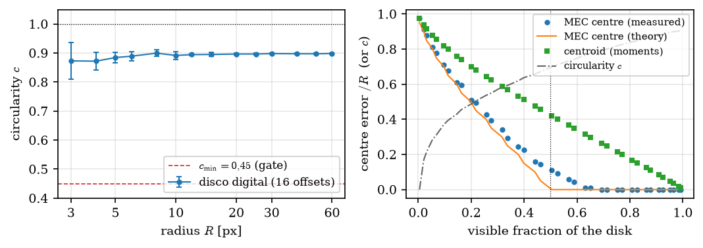

*Figure 7. (a) Circularity of digital disks against radius (mean and standard
deviation over 16 sub-pixel offsets); the asymptote is
$c_\infty \approx 0.899$ (Proposition 2). (b) Half-plane occlusion of a disk
with $R = 30$ px: MEC centre error (measured and theoretical, Proposition 4),
centroid error, and circularity.*

---

## 7. From pixel to world: lifting to the table plane

### 7.1 Back-projection

The pixel $(\hat{u}, \hat{v})$ defines the ray

$$
\mathbf{x}(\lambda) = \mathbf{O} + \lambda\,\mathbf{d}, \qquad
\mathbf{d} = R\,K^{-1}\tilde{\mathbf{u}}
= R \begin{bmatrix} (\hat{u} - c_x)/f_x \\ (\hat{v} - c_y)/f_y \\ 1 \end{bmatrix},
\qquad \lambda > 0.
\tag{7}
$$

The code normalises $\mathbf{d}$ (`_pixel_ray_cam`). That changes the
parameter $\lambda$ but not the intersection point. With the unnormalised
form of (7), since the third component of $K^{-1}\tilde{\mathbf{u}}$ is 1,
the value of $\lambda$ at the intersection equals the depth $Z$ of the point
in $\{C\}$.

### 7.2 The plane of centres

A sphere of radius $r$ resting on a horizontal plane at height
$z_{\text{table}}$ has its centre at $z = z_{\text{table}} + r$. The lifter
uses the plane

$$
\Pi = \{\mathbf{x} \in \mathbb{R}^3 : \mathbf{e}_z^{\mathsf{T}}\mathbf{x} = z_\Pi\},
\qquad z_\Pi = z_{\text{table}} + r,
$$

with $z_{\text{table}} = 0$ and $r =$ {{OmxBallr}} mm (OM-X) or
{{OmyBallr}} mm (OMY), read from `lifter` in the YAML. The intersection is

$$
\lambda^\star = \frac{z_\Pi - O_z}{d_z}, \qquad
\hat{\mathbf{p}} = \mathbf{O} + \lambda^\star\mathbf{d},
\tag{8}
$$

defined when $|d_z| \geq 10^{-12}$ (ray not parallel to the plane) and
$\lambda^\star > 0$ (plane in front of the camera). Otherwise the view is
discarded (`intersect_ray_horizontal_plane`).

**Proposition 5 (Model exactness).** If the true centre $\mathbf{p}^\star$
lies on $\Pi$, is in front of the camera, and
$(\hat{u}, \hat{v}) = \pi(\mathbf{p}^\star)$ is its exact projection by
Eq. (2), then Eq. (8) returns $\hat{\mathbf{p}} = \mathbf{p}^\star$.

*Proof.* By definition of central projection,
$\mathbf{p}^\star = \mathbf{O} + Z^\star\mathbf{d}$ with $\mathbf{d}$ from (7)
and $Z^\star > 0$. Since $d_z \neq 0$, the line meets $\Pi$ in exactly one
point, which is therefore $\mathbf{p}^\star$. $\blacksquare$

So, with a single camera, position error comes from only three sources:
centre pixel error (bias from Proposition 3, occlusion, digitisation),
plane-model error ($z_\Pi$), and calibration error. Each is quantified in
Section 8. An important consequence is that the estimated height is always
$z_\Pi$ by construction, so the $z$ error is zero as long as the ball really
rests on the table.

### 7.3 Multi-view fusion

For each configured camera $i$ that produced a detection, the lifter keeps the
one with highest confidence (the detector already returns at most one),
computes $\hat{\mathbf{p}}_i$ by (8), and fuses

$$
\hat{\mathbf{p}} = \sum_i w_i\,\hat{\mathbf{p}}_i, \qquad
w_i = \frac{\max(\kappa_i, 10^{-3})}{\sum_j \max(\kappa_j, 10^{-3})},
\tag{9}
$$

then re-imposes $\hat{p}_z = z_\Pi$ (`TablePlanePoseLifter.lift`). Since $\Pi$
is affine and (9) is a convex combination of points of $\Pi$, the
re-imposition only removes rounding. One view is enough: if one camera is
obstructed, the other alone defines $\hat{\mathbf{p}}$.

**Remark (Optimal weights).** If the $\hat{\mathbf{p}}_i$ were unbiased and
independent with in-plane covariances $\Sigma_i$, the minimum-variance linear
estimator would be
$\hat{\mathbf{p}} = \left(\sum_i \Sigma_i^{-1}\right)^{-1} \sum_i \Sigma_i^{-1}\hat{\mathbf{p}}_i$.
Eq. (9) uses scalar weights based on circularity rather than on $\Sigma_i$.
The two coincide when the views have equal covariances. Without occlusion,
$\kappa_L \approx \kappa_R \approx 0.89$ and the weights are
$\approx \frac{1}{2}$.

The output is a `BallObservation` with `position_world` $= \hat{\mathbf{p}}$,
`radius_m` $= r$, `timestamp` equal to the latest timestamp among the frames
used, and `source` equal to the pipeline id. The `covariance` field exists in
the type but the current lifter does not fill it (Section 8 shows how to
compute it), and `pickable` stays `None`.

### 7.4 Complete numerical example

Table 1 follows the computation in the OM-X cell with the ball at the default
pick pose,
$\mathbf{p}^\star = ({{OmxGtX}}, {{OmxGtY}}, {{OmxGtZ}})$ mm. Every value
comes from the real pipeline; the step-by-step re-implementation used to fill
the table reproduces the detector mask bit for bit and the fused position to
$10^{-12}$ m.

*Table 1. Complete example, OM-X, pose `pick_default`. Lengths in metres
unless stated.*

| | left camera ($L$) | right camera ($R$) |
|---|:---:|:---:|
| contours found | {{OmxLNContours}} | {{OmxRNContours}} |
| area $A$ / perimeter $P$ [px] | {{OmxLAreaPx}} / {{OmxLPerimeterPx}} | {{OmxRAreaPx}} / {{OmxRPerimeterPx}} |
| circularity $c = \kappa$ | {{OmxLCirc}} | {{OmxRCirc}} |
| IoU mask vs. segmentation | {{OmxLIou}} | {{OmxRIou}} |
| MEC centre $(\hat{u}, \hat{v})$ [px] | ({{OmxLU}}, {{OmxLV}}) | ({{OmxRU}}, {{OmxRV}}) |
| exact projection $\pi(\mathbf{p}^\star)$ [px] | ({{OmxLUGt}}, {{OmxLVGt}}) | ({{OmxRUGt}}, {{OmxRVGt}}) |
| centre error [px] | {{OmxLCentreErrPx}} | {{OmxRCentreErrPx}} |
| predicted bias $f\delta$ (Eq. 6) [px] | {{OmxLEllBias}} | {{OmxREllBias}} |
| MEC radius $\hat{\rho}$ / predicted $fa$ [px] | {{OmxLRadiusPx}} / {{OmxLEllA}} | {{OmxRRadiusPx}} / {{OmxREllA}} |
| $K^{-1}\tilde{\mathbf{u}}$ | ({{OmxLDcX}}, {{OmxLDcY}}, {{OmxLDcZ}}) | ({{OmxRDcX}}, {{OmxRDcY}}, {{OmxRDcZ}}) |
| $\mathbf{d} = RK^{-1}\tilde{\mathbf{u}}$ | ({{OmxLDwX}}, {{OmxLDwY}}, {{OmxLDwZ}}) | ({{OmxRDwX}}, {{OmxRDwY}}, {{OmxRDwZ}}) |
| optical centre $\mathbf{O}$ | ({{OmxLOX}}, {{OmxLOY}}, {{OmxLOZ}}) | ({{OmxROX}}, {{OmxROY}}, {{OmxROZ}}) |
| $\lambda^\star = (z_\Pi - O_z)/d_z$ | {{OmxLT}} | {{OmxRT}} |
| depth $Z$ of $\mathbf{p}^\star$ | {{OmxLDepth}} | {{OmxRDepth}} |
| $\hat{\mathbf{p}}_i$ [mm] | ({{OmxLPX}}, {{OmxLPY}}, {{OmxLPZ}}) | ({{OmxRPX}}, {{OmxRPY}}, {{OmxRPZ}}) |
| weight $w_i$ | {{OmxLWeight}} | {{OmxRWeight}} |
| **fused** $\hat{\mathbf{p}}$ [mm] | ({{OmxFuX}}, {{OmxFuY}}, {{OmxFuZ}}) | |
| **error** XY / $\lvert\Delta z\rvert$ [mm] | {{OmxExXyerr}} / {{OmxExZerr}} | |

Note that $\lambda^\star$ equals the depth $Z$, as predicted. In the OMY cell,
at the default pose $({{OmyGtX}}, {{OmyGtY}})$ mm, the same computation gives
$\hat{\mathbf{p}} = ({{OmyFuX}}, {{OmyFuY}}, {{OmyFuZ}})$ mm, a horizontal
error of {{OmyExXyerr}} mm. Figure 8 shows the rays and the in-plane errors.

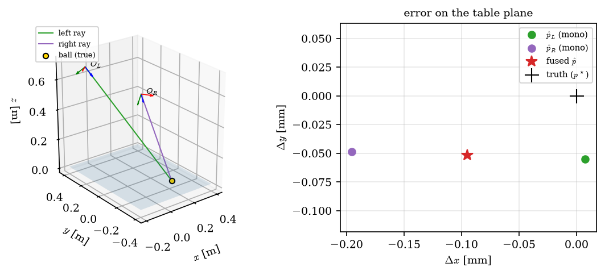

*Figure 8. Left: back-projection rays of both cameras (axes $x_C, y_C, z_C$
in red, green, blue) down to the plane $\Pi$ (OM-X). Right: error of the
monocular and fused estimates on the table plane, in millimetres.*

---

## 8. Error analysis

### 8.1 Jacobian of the lift

**Proposition 6.** Let $\mathbf{r}_k$ be the $k$-th column of $R$. The
derivative of the point (8) with respect to the pixel is

$$
\frac{\partial\hat{\mathbf{p}}}{\partial u}
= \frac{\lambda^\star}{f_x}\left(\mathbf{r}_1 - \frac{r_{1z}}{d_z}\mathbf{d}\right),
\qquad
\frac{\partial\hat{\mathbf{p}}}{\partial v}
= \frac{\lambda^\star}{f_y}\left(\mathbf{r}_2 - \frac{r_{2z}}{d_z}\mathbf{d}\right),
\tag{10}
$$

with zero $z$ component. Define
$J = [\partial_u\hat{\mathbf{p}} \;\; \partial_v\hat{\mathbf{p}}]_{xy} \in \mathbb{R}^{2 \times 2}$.

*Proof.* From (7), $\partial\mathbf{d}/\partial u = \mathbf{r}_1/f_x$. From
(8),
$\partial\lambda^\star/\partial u = -\lambda^\star(\partial d_z/\partial u)/d_z = -\lambda^\star r_{1z}/(f_x d_z)$.
By the product rule,
$\partial\hat{\mathbf{p}}/\partial u = (\partial\lambda^\star/\partial u)\mathbf{d} + \lambda^\star\,\partial\mathbf{d}/\partial u$,
which is the first expression. Its $z$ component is
$\frac{\lambda^\star}{f_x}(r_{1z} - r_{1z}) = 0$. The $v$ case is analogous.
$\blacksquare$

In the example, in mm/px,

$$
J_L = \begin{bmatrix} {{OmxLJAa}} & {{OmxLJAb}} \\ {{OmxLJBa}} & {{OmxLJBb}} \end{bmatrix},
\qquad
J_R = \begin{bmatrix} {{OmxRJAa}} & {{OmxRJAb}} \\ {{OmxRJBa}} & {{OmxRJBb}} \end{bmatrix},
$$

with largest singular values {{OmxLJsig}} and {{OmxRJsig}} mm/px. Formula
(10) agrees with central finite differences to {{OmxJacFd}} m/px. Figure 9
maps $\sigma_{\max}(J)$ over the table. Sensitivity grows with distance and
with ray obliquity, and fusion with equal weights reduces the covariance.

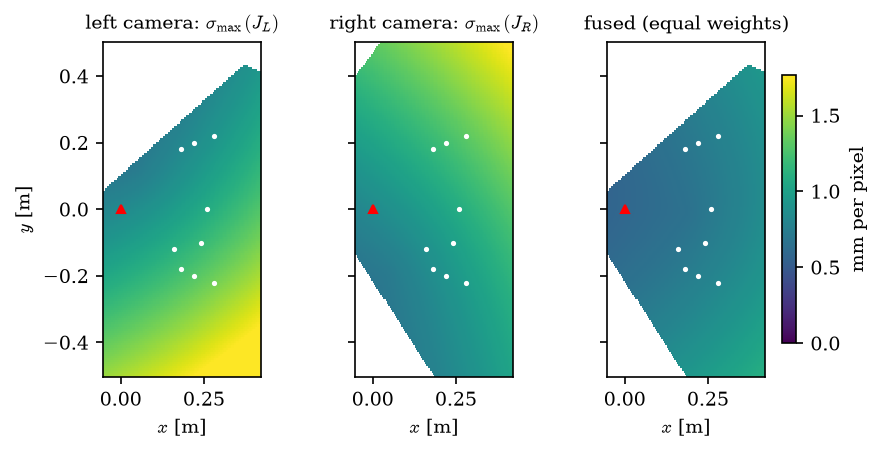

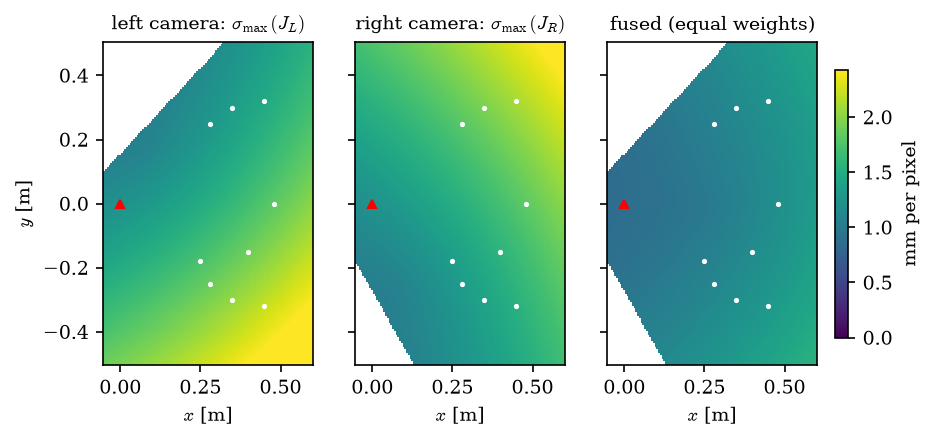

*Figure 9. Sensitivity $\sigma_{\max}(J)$ of the lifted point to pixel error
(mm/px) over the plane $\Pi$, only where the point projects inside the image.
Top: OM-X; bottom: OMY. White dots: sweep poses of Section 9; triangle: arm
base. The map ignores occlusion by the robot.*

### 8.2 Covariance propagation and Monte Carlo check

If the centre error in each view is independent with covariance
$\sigma^2 I_2$, linearisation gives

$$
\Sigma_i \approx \sigma^2 J_i J_i^{\mathsf{T}}, \qquad
\Sigma_{\hat{\mathbf{p}}} \approx \sum_i w_i^2\,\Sigma_i.
\tag{11}
$$

To check (11), we add Gaussian noise with $\sigma = 0.5$ px to the detected
centres of the example, repeat lift and fusion 20,000 times, and compare the
empirical covariance with the prediction. The semi-axes of the $1\sigma$
ellipse were ({{OmxMcEmpMinMm}}, {{OmxMcEmpMaxMm}}) mm (empirical) and
({{OmxMcPredMinMm}}, {{OmxMcPredMaxMm}}) mm (predicted), with a relative
Frobenius difference of {{OmxMcFrobRel}} (OMY: ({{OmyMcEmpMinMm}},
{{OmyMcEmpMaxMm}}) vs. ({{OmyMcPredMinMm}}, {{OmyMcPredMaxMm}}) mm).
Linearisation is therefore excellent at this scale, and (11) could fill the
`covariance` field of `BallObservation`.

### 8.3 Plane-model error

If the true centre is at $z_\Pi + \delta z$ (wrong configured radius, higher
table, or ball on a support), the ray through the true centre meets $\Pi$ at
$\mathbf{p}^\star - (\delta z / d_z)\mathbf{d}$. The horizontal error is

$$
\Delta\hat{\mathbf{p}}_{xy} = -\delta z\,\frac{\mathbf{d}_{xy}}{d_z}, \qquad
\|\Delta\hat{\mathbf{p}}_{xy}\| = |\delta z|\tan\theta,
$$

with $\theta$ the angle of the ray from the vertical. In the example,
$\tan\theta_L = {{OmxLTanIncidence}}$ and
$\tan\theta_R = {{OmxRTanIncidence}}$. In the fusion the shifts are vectors
and partly cancel because the cameras are on opposite sides: the fused error
is {{OmxDzShift}} mm per millimetre of $\delta z$ (OMY: {{OmyDzShift}}). For
example, a 1 mm error in the configured ball radius shifts the estimate by
$\approx 0.6$ mm.

### 8.4 Calibration error

A small camera rotation $\delta\phi$ deflects every ray by the same angle,
which to first order equals a pixel shift of $f\,\delta\phi$. With
$f \approx 938$ px and $\sigma_{\max}(J) \approx 1.3$ mm/px, 1 mrad of
orientation error is worth $\approx 0.94$ px $\approx 1.2$ mm. A translation
error $\delta\mathbf{O}$ moves $\hat{\mathbf{p}}$ by
$\delta\mathbf{O}_{xy} - \delta O_z\,\mathbf{d}_{xy}/d_z$. In simulation both
are zero to $10^{-10}$ (Section 2). In a real cell, extrinsic calibration is
likely to be the dominant error source.

### 8.5 Partial occlusion: case study

The worst case of the sweep is the OM-X `mid_backish` pose, with the ball at
$(0.16, -0.12)$ m (Figure 10). On the left camera the arm hides most of the
ball: only {{OccVisibleFrac}} % of the theoretical silhouette is visible. The
circularity of the visible part is {{OccCirc}}, above $c_{\min} = 0.45$, so
the detection is accepted. The MEC falls in regime (ii) of Proposition 4.
With a straight occluder the model would predict $h \approx 14$ px for that
visible fraction; the measured centre error is {{OccCentreErrPx}} px (the arm
edge is not straight). The left monocular estimate is off by {{occLeftErr}}
mm, while the unoccluded right one is off by {{occMonoErr}} mm. Because the
low circularity gives weight $w_L = {{occLeftW}}$, fusion attenuates but does
not remove the error: the fused result is off by {{occFusedErr}} mm. That is
still within the 15 mm benchmark tolerance, but it exposes the weak spot of
the weighting scheme (Section 11).

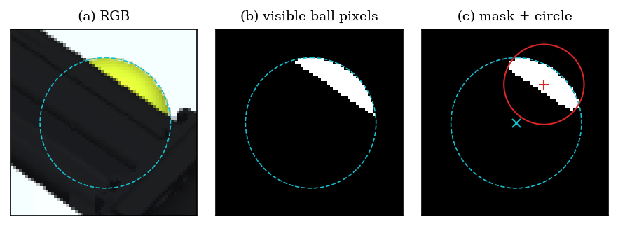

*Figure 10. Partial occlusion by the arm (OM-X, `mid_backish`, left camera).
Dashed cyan: full theoretical silhouette (Proposition 3); ×: exact projection
of the centre; red: MEC of the mask and estimated centre.*

---

## 9. Results in simulation

Tables 2 and 3 repeat the nine poses of `scripts/benchmark_mujoco_vision.py`.
For each camera, the "visible" column is the ratio between the ball pixels in
the reference segmentation and the theoretical silhouette area $\pi f^2 ab$.
It measures occlusion directly.

*Table 2. OM-X sweep ($L$ / $R$ = left / right camera). XY error of the fused
estimate against the true MuJoCo ball position.*

| pose | $(x, y)$ [m] | views | visible [%] | $c$ | centre error [px] | XY error [mm] |
|---|:---:|:---:|:---:|:---:|:---:|:---:|
{{SWEEP_OMX}}

*Table 3. OMY sweep. In `front_cone` the ball is inside the place bin (0.28 m
walls); only a cap of about 11 % shows above the wall, and it does not pass
the area and circularity filters. The pipeline returns `None` and does not
invent a pose.*

| pose | $(x, y)$ [m] | views | visible [%] | $c$ | centre error [px] | XY error [mm] |
|---|:---:|:---:|:---:|:---:|:---:|:---:|
{{SWEEP_OMY}}

For a spatial view, Figure 11 sweeps the ball over a dense grid:
{{OmxGridN}} positions for OM-X and {{OmyGridN}} for OMY, with the arm in its
sensing configuration. When both cameras see more than 95 % of the silhouette
({{OmxGridClearN}} positions for OM-X and {{OmyGridClearN}} for OMY), the XY
error has median {{OmxGridClearMedian}} mm and maximum {{OmxGridClearMax}} mm
(OM-X), and median {{OmyGridClearMedian}} mm and maximum {{OmyGridClearMax}}
mm (OMY), consistent with the pixel analysis of Section 8. Elsewhere the
errors cluster in well-defined bands where the arm or the bin walls cover part
of the ball in one view (regime (ii) of Proposition 4). Over the full grid,
the median is {{OmxGridMedian}} mm and the 95th percentile {{OmxGridPjf}} mm
(OM-X); for OMY, the median is {{OmyGridMedian}} mm and the 95th percentile
{{OmyGridPjf}} mm. OM-X detects the ball at all {{OmxGridN}} positions, and
OMY at {{OmyGridDet}} of {{OmyGridN}}. The OMY misses are inside the place bin
or in the corner $x \approx 0.15$ m, $y \approx 0.4$ m, where no camera has an
unobstructed view.

| OM-X | OMY |
|:---:|:---:|
| 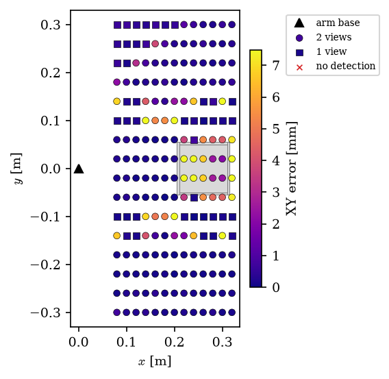 | 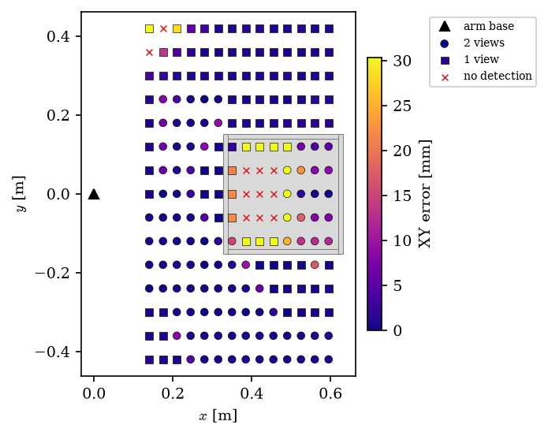 |

*Figure 11. XY error of the fused estimate over a dense grid of ball
positions. Circle: two views; square: one view; ×: no detection. Grey: place
bin. The colour scale saturates at the 95th percentile.*

---

## 10. From ball position to grasp pose

### 10.1 Why position is enough

A homogeneous sphere is invariant under any rotation about its own centre.
The action of $SE(3)$ on the sphere has stabiliser $SO(3)$ (rotations about
the centre), and the space of distinguishable poses is the quotient
$SE(3)/SO(3) \cong \mathbb{R}^3$. The object "pose" is therefore exactly the
centre position $\hat{\mathbf{p}}$, which is what `BallObservation` carries.
Vision does not impose the gripper orientation: it is free and chosen by
inverse kinematics.

### 10.2 Cartesian targets

From $\hat{\mathbf{p}}$, `_pad_mid_pick_waypoints`
(`fret/control/pick_place_vision.py`) defines three targets for the midpoint
between the fingertips:

$$
\mathbf{p}_{\text{hover}} = \hat{\mathbf{p}} + h_{\text{hover}}\mathbf{e}_z,
\qquad
\mathbf{p}_{\text{grasp}} = \hat{\mathbf{p}} + 0.012\,\mathbf{e}_z,
\qquad
\mathbf{p}_{\text{lift}} = \hat{\mathbf{p}} + h_{\text{lift}}\mathbf{e}_z,
$$

with $(h_{\text{hover}}, h_{\text{lift}}) = (0.08, 0.12)$ m for OM-X and
$(0.10, 0.14)$ m for OMY. The 12 mm offset above the centre at grasp lets the
fingers close on the sphere without touching the table. The gripper opening is
fixed per target: open at hover, closed ("pinch") at grasp and lift.

### 10.3 Fingertip-midpoint inverse kinematics

Let
$\mathbf{m}(\mathbf{q}) = \frac{1}{2}\left(\mathbf{x}_{\text{R}}(\mathbf{q}) + \mathbf{x}_{\text{L}}(\mathbf{q})\right)$
be the midpoint of the `pad_right` and `pad_left` geom centres, computed by
MuJoCo forward kinematics, with $\mathbf{q} \in \mathbb{R}^n$ ($n = 4$ for
OM-X, $n = 6$ for OMY). For each target $\mathbf{p}_\ast$ we solve

$$
\mathbf{q}_\ast = \arg\min_{\mathbf{q} \in [\mathbf{q}_{\min}, \mathbf{q}_{\max}]}
\|\mathbf{m}(\mathbf{q}) - \mathbf{p}_\ast\|^2
\tag{12}
$$

with L-BFGS-B [7] (`pad_mid_ik`, `fret/control/omy_pad_mid_ik.py`) from
several seeds: the previous target's solution (warm start), the scenario YAML
configurations, and robot-specific seeds. The lowest-residual solution is
kept. If the residual $\|\mathbf{m}(\mathbf{q}_\ast) - \mathbf{p}_\ast\|$
exceeds 8 mm, the routine raises instead of sending a poor grasp. Because
OM-X has 4 degrees of freedom and the target has 3 dimensions, (12) generally
has a family of solutions; the seeds select among them. In the example of
Table 1, the residuals were {{OmxIkHoverMm}} mm (hover), {{OmxIkGraspMm}} mm
(grasp), and {{OmxIkLiftMm}} mm (lift) for OM-X, and $\leq$ {{OmyIkGraspMm}}
mm for OMY. Cartesian positioning error is therefore dominated by vision, not
by IK.

### 10.4 Integration with the state machine

In the simulators (`simulate_pick_place` and `simulate_omy_pick_place`),
vision runs once, before the arm folds into its idle posture. The order
matters because the folded posture occludes one camera.
`apply_vision_pick_goals` renders the cameras, runs the pipeline, and raises
if there is no `BallObservation`: the system never grasps blind. With an
observation, it replaces the state machine's pick configurations (the place
configurations still come from the YAML, because the place bin is a known
fixture) and moves the visual `cv_ball_ghost` sphere to $\hat{\mathbf{p}}$
(Figure 3).

---

## 11. Limitations and possible improvements

1. **Cross-view association.** Each camera picks its own blob with the
   highest circularity, and nothing checks that the views saw the same
   object. With two balls visible, Eq. (9) can average two different objects
   and produce a point between them. A consistency test
   $\|\hat{\mathbf{p}}_L - \hat{\mathbf{p}}_R\| \leq \tau$ (for example
   $\tau = 3\sqrt{\operatorname{tr}(\Sigma_L + \Sigma_R)}$) would catch this
   case.
2. **Partial occlusion.** Circularity only reduces the weight of an occluded
   view (Section 8.5). Alternatives: reject views whose $\hat{\rho}$ is much
   smaller than the predicted radius $f\,a(\hat{\mathbf{p}})$ (Corollary 1
   gives the prediction from the other view's estimate), use minimum-variance
   weights with $\Sigma_i$ inflated by $1/c_i$, or apply the consistency test
   of the previous item.
3. **Perspective bias.** At most $\approx 1.4$ px; it can be corrected in
   closed form with Eq. (6).
4. **Plane assumption.** The $z$ estimate is imposed. A ball off the table
   (on an obstacle, or in the air) causes a horizontal error of
   $\delta z\tan\theta$. With two views, least-squares triangulation could
   estimate $z$ and serve as a diagnostic.
5. **Colour and lighting.** The HSV threshold is fixed. It works well in
   simulation (Figure 4), but real cameras need colour calibration and a
   lens-distortion model, which is absent today.
6. **Uncertainty.** The `covariance` field can be filled with Eq. (11),
   validated by the Monte Carlo experiment.

---

## Appendix A. Configuration parameters

| parameter | OM-X (`omx_portal_overhead.yml`) | OMY (`omy_portal_overhead.yml`) |
|---|---|---|
| resolution | $1280 \times 720$ | $1280 \times 720$ |
| `fovy` / $f$ [px] | {{OmxFovy}}° / {{OmxFx}} | {{OmyFovy}}° / {{OmyFx}} |
| optical centres $\mathbf{O}$ [m] | $(-0.12, \pm 0.30, 0.70)$ | $(-0.18, \pm 0.42, 0.98)$ |
| $\boldsymbol{\ell}$ / $\mathbf{h}$ (HSV) | $(20, 40, 40)$ / $(50, 255, 255)$ | $(20, 40, 40)$ / $(50, 255, 255)$ |
| structuring element | elliptical $5 \times 5$ | elliptical $5 \times 5$ |
| $A_{\min}$ / $A_{\max}$ [px²] | 80 / 500,000 | 120 / 500,000 |
| $c_{\min}$ | 0.45 | 0.45 |
| $z_{\text{table}}$ / $r$ [m] | 0 / 0.020 | 0 / 0.043 |

*Table 4. Pipeline parameters for the two gate cells. `config/vision/` also
has `hsv_blob_overhead.yml` (synthetic fixture, $640 \times 480$,
$c_{\min} = 0.55$) and `hsv_blob_tennis_yellow.yml` (web photos).*

## Appendix B. Reproducibility

Every figure, table, and number in this document is generated by

```bash
MUJOCO_GL=egl PYOPENGL_PLATFORM=egl python3 scripts/vision_algorithm_figures.py
cd docs/vision/algorithm && latexmk -pdf vision_algorithm.tex
```

The script uses the production pipeline (`pipeline_from_hsv_plane_config`)
and asserts that the step-by-step re-implementation matches it: identical
mask, same detection centre, and fused position equal to $10^{-12}$ m. Raw
metrics are in `metrics.json`. The same run renders `vision_algorithm.md`
(this file) from `vision_algorithm.template.md`; edit the template, not the
generated file.

## References

1. R. Hartley and A. Zisserman. *Multiple View Geometry in Computer Vision*,
   2nd ed. Cambridge University Press, 2004.
2. J. Serra. *Image Analysis and Mathematical Morphology*. Academic Press,
   1982.
3. S. Suzuki and K. Abe. Topological structural analysis of digitized binary
   images by border following. *Computer Vision, Graphics, and Image
   Processing*, 30(1):32–46, 1985.
4. E. Welzl. Smallest enclosing disks (balls and ellipsoids). In *New Results
   and New Trends in Computer Science*, LNCS 555, pp. 359–370. Springer, 1991.
5. A. R. Smith. Color gamut transform pairs. *ACM SIGGRAPH Computer
   Graphics*, 12(3):12–19, 1978.
6. H. Freeman. On the encoding of arbitrary geometric configurations. *IRE
   Trans. Electronic Computers*, EC-10(2):260–268, 1961.
7. R. H. Byrd, P. Lu, J. Nocedal, and C. Zhu. A limited memory algorithm for
   bound constrained optimization. *SIAM J. Sci. Comput.*,
   16(5):1190–1208, 1995.
8. G. Bradski. The OpenCV Library. *Dr. Dobb's Journal of Software Tools*,
   2000.
